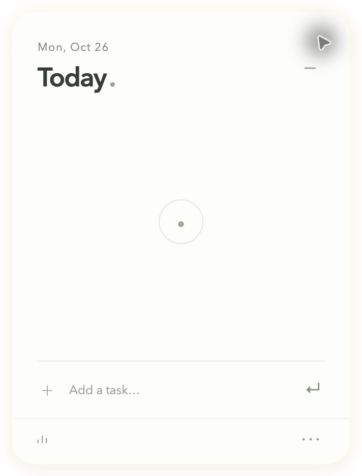
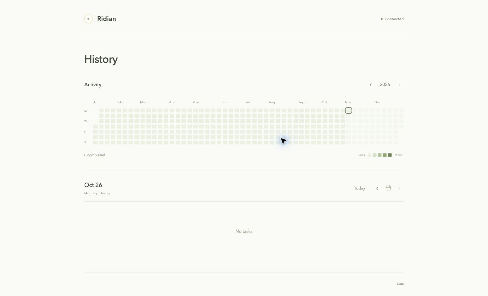

# Ridian

[](README.md) [](README.zh-CN.md)

A quiet daily task list that floats on your desktop. A white orb, a soft golden glow, gentle completion animations, and local records your AI can read and manage. The interface is in English; task titles support Chinese and other languages.

- **Always within reach.** Expand the orb to see today. It fades to translucent when you switch to another app.
- **Priorities, with room to rearrange.** A horizontal slider with four priority levels. Drag tasks into any order to override the defaults.
- **A record of each day.** An annual activity heatmap, daily lists, and simple completion statistics.
- **Ready for your AI.** A local HTTP API, separate read and write keys, and recurring tasks based on intervals, weekdays, or specific dates.

## Preview

These earlier English interface screenshots show empty states without personal tasks. The current app also includes a priority slider and free task reordering, which are not shown here.

<p align="center">
  
</p>

<p align="center">
  
</p>

## Quick start

The desktop app currently targets **Apple Silicon macOS**. Requires **Node.js 22.12 or later**.

```sh
git clone https://github.com/MonadWorks/ridian.git
cd ridian
npm ci
npm start
```

Build an app you can open independently:

```sh
npm run package
open release/Ridian-darwin-arm64/Ridian.app
```

You can also copy the built `Ridian.app` into `~/Applications/`. Local builds use ad-hoc signing and are not notarized by Apple. Distribution to other Macs requires the appropriate signing and notarization process.

The [online history page](https://ridian-journal.vercel.app) can connect to Ridian running on the same Mac. Choose **Demo** to explore sample data.

## Using Ridian

- Open `Ridian.app`. Click the orb to expand it. Click the minus button in the upper right or press **Esc** to collapse it.
- Use the small arrows beside the heading to switch days. Click the date to open an English calendar and jump to any day; a subtle dot marks dates with tasks. Away from today, the calendar-with-a-dot icon takes you straight back to today.
- Add a task while viewing a future date to schedule it for that day, with your chosen priority. Future dates show their scheduled tasks; today includes due tasks and unfinished carryover. Each day's list supports free reordering. The orb always counts today's pending tasks. Your selected day and draft stay in place when you collapse and reopen the panel; restarting opens today. The Today view advances at midnight, while an explicitly selected date stays selected. Completing a future task early records the actual completion day and retains its planned date.
- Drag the orb or the panel header to move it. Switch to another app to make it translucent; hover over Ridian to restore its opacity.
- Type a task and press **Enter** to add it. Click its circle to complete it, or click again to undo. **Click the task text to edit it in place.** Press **Enter** or click elsewhere to save, **Esc** to cancel, or **Shift + Enter** for a line break. You can also focus the task text and press **Enter** or **F2** to edit. Editing keeps the task's date, priority, completion state, and manual order; if saving fails, your draft stays open for retry.
- Set a priority **before adding a task** using the button beside **Add a task**. Drag the white slider horizontally: the track changes color continuously, then snaps to **Low / Normal / High / Urgent** on release. It resets to Normal after a successful addition. Click an existing task's colored dot to use the same slider. Use **← / →** to select, **Enter** to confirm, or **Esc** to cancel. Priority changes animate the list into its new order where the default ordering applies. Priority is also available in the context menu.
- By default, pending tasks appear from highest to lowest priority, with completed tasks at the bottom. Drag task text or the handle that appears on hover to move any task across priority levels or completion states. Your order persists through refreshes and restarts. New tasks are inserted using the default rules; newly completed tasks move to the bottom and can be dragged again. Choose **Reset order** in the menu to restore the defaults. With a drag handle focused, use **↑ / ↓**, **Home**, or **End** to move a task.
- Hover over a task to reveal its delete button. Unfinished tasks carry over into today while retaining their original planned date.
- Press **⌘ ⇧ Space** to expand or collapse. The menu bar circle also opens the list; right-click it for the menu.
- Open history from the lower left. The **···** menu provides export, AI access, online history, launch at login, and quit.

History includes an annual heatmap, daily task lists, total completions, active days, and the longest streak. The heatmap counts tasks on the day they were actually completed. Planned dates and later completion dates are retained separately. Undoing a completion also updates the statistics.

## Data and connections

Data is stored in `~/Library/Application Support/Ridian/`:

| File | Contents |
| --- | --- |
| `journal.json` | Tasks, recurring strategies, and manual order. Writes use a temporary file, `fsync`, and atomic replacement. |
| `backups/YYYY-MM-DD.json` | A backup made before the first change each day. |
| `connection.json` | The local HTTP address, a read-only `readToken`, and a writable `writeToken`. File permissions are `0600`. |
| `preferences.json` | The floating orb's position. |

The local history page and desktop app share the same data. The Vercel-hosted page reads through the local API; your browser may ask for local network access. Keep Ridian running on the same Mac. After the app quits, the page displays its most recently cached snapshot. **This version does not provide cloud data sync or automatic sync across devices.** Export JSON to view a backup in the history page on another device. **Open backup** is a read-only preview and does not overwrite desktop data. **Disconnect** clears the browser's connection and cached snapshot.

The online history link carries only a read-only key, passed through the URL fragment. The page removes it from the address bar immediately after reading it; the fragment is not sent to Vercel. Connection keys are kept in the current tab's `sessionStorage`. Task snapshots are cached in that browser's `localStorage`. Disconnect when you want to clear them.

## AI HTTP API

Base URL: `http://127.0.0.1:43127`. Every data endpoint requires `Authorization: Bearer <token>`. Use `Content-Type: application/json` for JSON request bodies. The service listens only on the loopback address. CORS permits only local pages and the configured deployment origins.

Copy a read-only or read/write configuration from Ridian's **AI access** menu. A local AI tool can also read `connection.json` at the location above. Do not commit or publicly upload this file.

| Method | Path | Purpose |
| --- | --- | --- |
| GET | `/api/v1/today` | Today's tasks, including unfinished tasks from earlier days |
| GET | `/api/v1/tasks?date=2026-10-26` | Tasks planned or completed on a date; omit `date` for all tasks |
| GET | `/api/v1/history` | Full records, strategies, time zone, and current local date |
| GET | `/api/v1/export` | Full JSON backup |
| POST | `/api/v1/tasks` | Add a task |
| PATCH | `/api/v1/tasks/:id` | Update title, priority, planned date, or completion state |
| DELETE | `/api/v1/tasks/:id` | Delete a task |
| POST | `/api/v1/order` | Move a task: `{"id":"task-id","beforeId":"target-id","date":"2026-10-27"}`; `date` defaults to today, and `beforeId:null` moves it to the end of that day's list |
| DELETE | `/api/v1/order` | Restore the default order |
| GET / POST | `/api/v1/strategies` | List / create recurring strategies |
| PATCH / DELETE | `/api/v1/strategies/:id` | Update / delete a strategy |

Write requests using a read-only key return `403`. Invalid keys return `401`. Successful creation and updates return `200` with JSON.

Add a task:

```json
{"title":"Review chapter one","date":"2026-10-27","priority":"high"}
```

`date` defaults to today. `priority` defaults to `normal` and accepts `urgent`, `high`, `normal`, or `low`.

Update a task:

```json
{"done":true}
```

Use `done:false` to undo completion. You can update `title`, `date`, and `priority` independently.

Review every three days:

```json
{
  "title":"Review chapter one",
  "priority":"high",
  "startDate":"2026-10-27",
  "endDate":"2026-12-31",
  "schedule":{"type":"interval","everyDays":3},
  "metadata":{"source":"ai","topic":"Chapter one"}
}
```

Repeat on Mondays and Fridays:

```json
{"title":"Weekly review","schedule":{"type":"weekly","weekdays":[1,5]}}
```

Schedule specific review dates, with intervals calculated by your AI:

```json
{
  "title":"Spaced repetition review",
  "startDate":"2026-10-27",
  "schedule":{"type":"dates","dates":["2026-10-27","2026-10-28","2026-10-30","2026-11-03","2026-11-10"]},
  "metadata":{"reviewIntervals":[0,1,3,7,14],"notes":"AI strategy context can be stored here"}
}
```

`weekdays` uses `0` for Sunday through `6` for Saturday. Set `enabled:false` to pause a strategy. Pausing or deleting a strategy does not delete tasks it has already generated. The app checks every 30 seconds and catches up on startup or API access. Each strategy generates at most one task per date; future occurrences are generated when their date arrives. Scheduling follows the computer's current local date and time zone. Nothing runs after the app quits; reopening it catches up on missed occurrences. Strategy `metadata` accepts a JSON object up to 4,000 characters to hold your AI's review logic. This version does not include hourly reminders, push notifications, or automatic AI reasoning.

A minimal Python example for an AI tool to read today's tasks without printing the key:

```python
import json, pathlib, urllib.request
config = json.loads((pathlib.Path.home() / 'Library/Application Support/Ridian/connection.json').read_text())
request = urllib.request.Request(config['baseUrl'] + '/api/v1/today', headers={'Authorization': 'Bearer ' + config['readToken']})
print(urllib.request.urlopen(request).read().decode())
```

## Development and checks

```sh
npm test
# Preview the floating panel with synthetic data, without accessing personal tasks
npm run preview:widget
# Run desktop and web interaction checks separately; quit Ridian first to free its port
node tests/desktop-smoke.cjs
npm run build
npm run package
```

`npm run build` creates a deployable `dist/` directory with no third-party runtime dependencies. The desktop app uses Electron; the static frontend uses vanilla JavaScript and CSS. `desktop/cloud.json` holds the online history URL allowed to read local data. If you change the deployment domain, update this file and rebuild the desktop app.

When editing documentation, update both `README.md` and `README.zh-CN.md`. Keep the language buttons at the top and keep features, commands, examples, and limitations equivalent. Use only empty states or synthetic data in preview images.

## License

[MIT](LICENSE).
